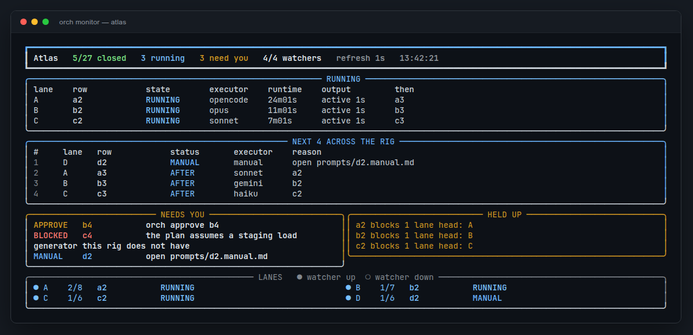
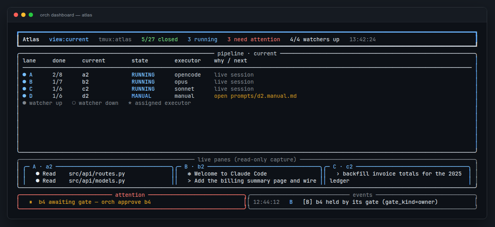
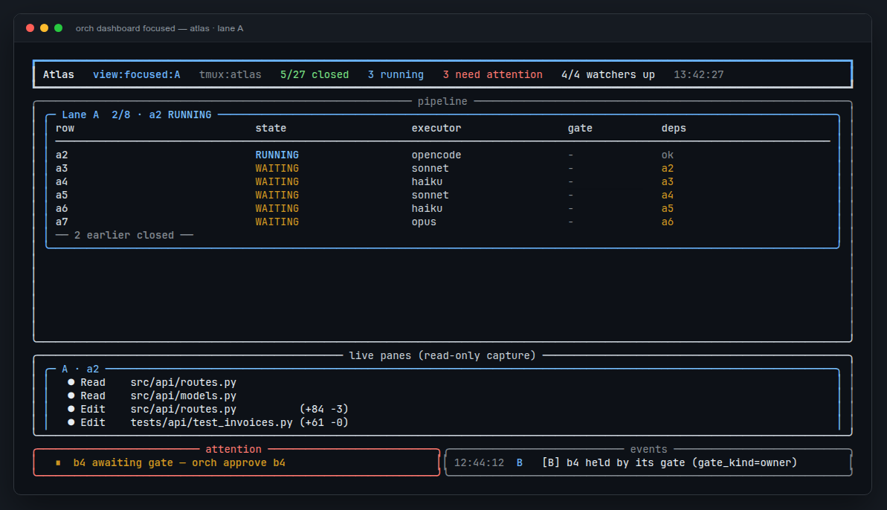
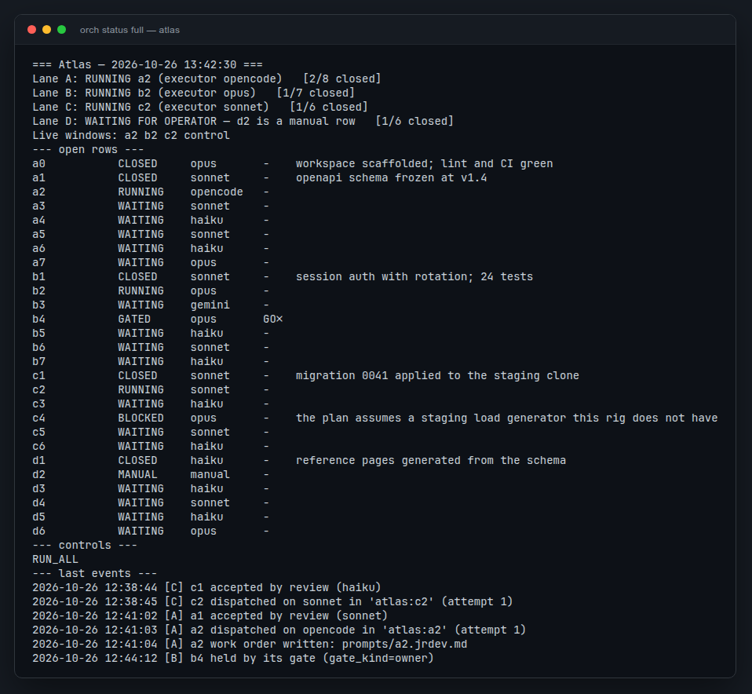
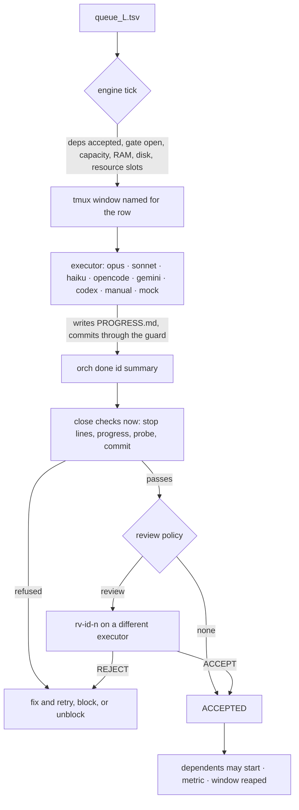

# orch-harness

**Run a ladder of work across many AI agents in parallel — each one a visible
tmux window, each claim verified before anything that depends on it starts.**

[](https://github.com/SharanSivakumar/orch-harness/actions/workflows/ci.yml)
[](https://github.com/SharanSivakumar/orch-harness/releases)
[](LICENSE)

`orch-harness` is a repo-agnostic orchestration rig for long-running agent work.
A project brings an `orch.yaml`, queue files and plans; this repository supplies
the engine. Rows are the unit of work: an id, its dependencies, a plan path and
an executor. The engine dispatches ready rows into named tmux windows, watches
them, checks their close claims, gets independent review where configured, and
only then lets dependents run.

It is deliberately **not** a chat UI, a prompt library, or a hosted service. It
is the scheduler, the guard rails and the paper trail around the agent CLIs you
already use.



---

## What it looks like

The screenshot above is `orch monitor`: a one-second, read-only glance at a whole
rig — what is running, which lane heads are next, what needs you, and what is
holding progress.

`orch dashboard` — the default compact view. It adapts to short terminals and
keeps every lane visible; `focused` and `full` expand the ladders.



`orch dashboard focused --lane A` — one lane's full ladder plus a live,
read-only capture of the running session.



`orch status full` — the same resolved state without a TUI. It is the
authoritative answer for scripts, the Telegram bot and `orch json`.



The screenshots come from a four-lane demo rig. `orch init` starts you with one
lane (`queue_A.tsv`); every additional `queue_<L>.tsv` becomes another lane.

---

## Why it exists

Running many agents in parallel usually fails in the same four places:

1. **You cannot see them.** A headless batch tells you a row "finished"; it does
   not tell you whether the work is true. Here every session is a real tmux
   window. `orch attach` and watch any one.
2. **A bare sentinel is treated as success.** An agent can print `CLOSED` over a
   failed test. Here a claim is **judged**: stop lines, `PROGRESS.md`, acceptance
   probes, commits and protected paths are checked, and (by policy) an
   independent reviewer on a different model re-verifies the claim.
3. **A crash takes the whole rig down.** Here an interrupted session is detected
   (boot id, tmux session age) and re-dispatched without being charged; dead
   windows are recorded; executor breakers stop a broken CLI from burning the
   whole ladder.
4. **Someone must babysit every halt.** The optional **Steward lane** turns
   halts, held gates, waiting manual rows and rest states into incidents it can
   resolve through engine-checked actions, each logged with its undo. Only the
   page classes you allow reach your phone.

The engine is one Python process per rig (`tick_seconds`), not one watcher per
lane. Config edits are picked up live.

---

## How a row runs



A `BLOCKED` claim from a junior row gets an unblocker session (`ub-<id>-<n>`)
that fixes the *plan*, not the deliverable. After the configured attempts the
row is retiered once; a further block halts it and pages you. A `ROUTE_A`
escalation always halts.

---

## Install

Requirements: `bash`, `tmux` ≥ 3, `python3` ≥ 3.10, `pyyaml`, and `rich` for the
TUI.

```bash
git clone https://github.com/SharanSivakumar/orch-harness.git ~/orch-harness
ln -s ~/orch-harness/bin/orch ~/.local/bin/orch
orch version
```

Nothing is built and no daemon is installed. The only optional system service is
`orch service install` (systemd user units) for reboot survival.

Optional first step after cloning: `tests/run_all.sh` stamps `.tested/<commit>`,
which tells `orch start` this checkout has passed its suites. It is not required
to try the rig.

Keep instances outside the framework checkout: `orch start` refuses to run from
a dirty framework tree, so do not `orch init` inside `~/orch-harness`.

## Five-minute start

```bash
orch init ~/projects/my-rig/ORCH --name "My project" --session myrig
cd ~/projects/my-rig/ORCH

$EDITOR orch.yaml queue_A.tsv      # a lane, a few rows (see below)
./orch lint                        # validate before dispatching anything
./orch start                       # bring the engine up in tmux
./orch monitor                     # watch it, read-only (Ctrl-C to leave)
```

A fresh instance starts with:

```text
ORCH/
  orch.yaml            instance config
  queue_A.tsv          lane A ladder (any queue_<L>.tsv is a lane)
  orch                 self-locating CLI wrapper (safe to commit)
  prompts/             per-instance work-order templates (win over the framework's)
  state/               claims, results, dispatch records, telemetry
  control/             RUN_<lane>, PAUSE, STOP, GO_<row>, …
  leases/  unblock/
```

As it runs, it also grows `archive/`, `rounds/`, `steward/`, `digest/` and
`reviews/`.

For a guided setup with a human, an agent follows
[`docs/SETUP_AGENT_GUIDE.md`](docs/SETUP_AGENT_GUIDE.md); for planning the work
itself, [`docs/PLANNING_AGENT_GUIDE.md`](docs/PLANNING_AGENT_GUIDE.md).

---

## The three paths

The most common setup mistake is collapsing these. They are separate on purpose:

| Setting | What it is | Example |
|---|---|---|
| `instance` | the folder holding `orch.yaml`, state, control and prompts | `~/projects/my-rig/ORCH` |
| `project.workspace` | what queue plan paths and reports are relative to | `~/projects/my-rig` |
| `project.root` | every executor's working directory | `~/projects/app` |
| `guard.git_repo` | the repo the guard stages and commits into | `~/projects/my-rig` |

`root` and `git_repo` can differ: agents work from the code repository, while
plan and report commits land in a separate docs repository.

## The queue

`queue_<LANE>.tsv`, whitespace-separated, `#` comments:

```text
# id   deps     gate  executor  plan_path                    [extras]
setup  -        0     opus      PHASE_A/setup/PLAN.md
b0     setup    0     opencode  PHASE_A/b0/PLAN.md           res=db  prio=5
l1     b0       1     sonnet    PHASE_A/l1/PLAN.md           reviewer=opus  timeout=90
r1     l1,b0    0     opus      PHASE_A/r1/PLAN.md           PHASE_A/l1
```

- **deps** — comma-separated row ids (any lane), or `-`. A dep is met when it is
  **accepted**, never on a bare claim.
- **gate** — `1` parks the lane before this row until `orch approve <id>` (or the
  Steward, for `gate_kind=steward`).
- **plan_path** — relative to the workspace. Its *directory* becomes the row's
  allowlist automatically.
- **extras** — tokens with `=` are metadata (`res`, `review`, `reviewer`,
  `timeout`, `prio`, `accept`, `preflight`, `rearm`, `gate_kind`, `needs`); the
  rest are extra allowlist paths.

Appending or editing rows while the engine runs is safe and is the intended
workflow. With `guard.queue_watch: true`, edits made outside `orch row add` are
reported in the digest unless an operator commits or accepts them.

## Claims

A row closes with:

```bash
orch done <id> "one-line summary"              # normal close
orch done <id> "…" --outcome nogo|held|fail|infeasible   # a verdict row's answer
orch blocked <id> "precise reason"              # stop; unblock if junior
orch escalate <id> "why only the Owner can decide this"   # ROUTE_A: halt and page
```

`orch done` writes `state/<id>.status` only after the close checks pass. A
session that writes the file itself, or ends with
`ORCH_CLOSE <id> <VERDICT> — <summary>`, is judged the same way. Unblockers,
reviewers and plan reviewers use `orch verdict <session> <VERDICT> "…"`.

What can refuse a close:

- a `STOP`, `REFUSED` or `HEADS_UNCHANGED no` line in the row's evidence without
  a signed ruling in `PROGRESS.md` (`SIGNED_RULING <id>`);
- missing `PROGRESS.md`, or one written before dispatch;
- a placeholder summary;
- a failing acceptance probe (`<plan dir>/ACCEPT.sh` or `accept=<file>`);
- a change to a protected path (`guard.protected_paths`) since the row's first
  dispatch.

## The allowlist, derived

For row `id` with plan `PHASE_A/thing/PLAN.md`:

```text
PHASE_A/thing              the row's own phase folder
REPORTS/id_                its report-pack prefix
<guard.shared_paths>       what every closing row touches
<queue extras>             explicit extra paths
<phase folder>/ALLOWLIST   one path per line, if present
```

Check any row with `orch guard allowlist <id>`. `orch commit <id> -m "…" -- <paths>`
stages only those paths; for shared files it stages only the hunks whose changed
lines name the row id.

---

## Commands

The full list is in `orch --help`; grouped by what you are doing:

### Rig

```text
orch init [dir] [--preset strict] [--name …] [--session …]
orch setup questions|apply|defaults|rules|card|check
orch lint | preflight [--round R|ids|--pending] [--run] [--review]
orch start [lanes…] | disable <lanes…> | day | night
orch pause [lane] | resume [lane] | stop [lane] | unstop
orch status [full] · orch json · orch dashboard [current|focused|full] · orch monitor · orch attach
orch report [--round R] [--json]
orch engine status|stop|log|tick | migrate [--apply …]
```

### Rows

```text
orch assign <id> <executor|default> | assignments [all] | approve <id> | dispatch <id>
orch done <id> "…" | blocked <id> "…" | escalate <id> "…" | verdict <session> <V> "…"
orch reset <id> | adopt <id> | prompt <id>… | --all-pending | closecheck <id>
orch rearm <id> "reason" | rearm round-start <tag> "reason"
orch row add <lane> "<queue line>" "why" | row diff | row sync ["why"]
```

### Rounds and decisions

```text
orch round new|add-lanes|start|status|close|list|review|archive|score …
orch archive <lanes…> | --complete        orch score [--show]
orch gd next [--reserve "title"] | index | digest | show <id> | grep <re> | set-status | check
```

### Guard and resources

```text
orch hold <id> <res>[,<res>…] -- <cmd…>   orch lease acquire|release <res> <owner>
orch commit <id|plan:TAG> -m "msg" -- <paths…>
orch guard status|allowlist|protected|force-release
orch longrun [--venv <dir>] <log> -- <cmd…>   orch venvcheck <venv>
```

### Autonomy (all off or neutral by default)

```text
orch service install|uninstall|status
orch steward status|incidents|log|inbox [done <k> [LETTER] ["note"]]
orch steward wake "why" | close <n> "why"
orch park <id> ["why"] | unpark <id> | revert [<k> [--dry-run]] | why <id>
orch executor status | fallback <X> [--dry-run] | restore <X> ["why"]
orch spend run --provider P --est USD [--row id] -- <cmd…>
orch spend status|ledger|caps [approve]|answer <id> A|B
orch phase open|rest|close <P> … | status | approve | off
orch digest [--send] [--since <epoch>]
orch bot start|stop|status|test|doctor|poll   orch notify "T" "B"
```

---

## Configuration that matters

`orch.yaml` is re-read when it changes. Defaults are safe: nothing is dispatched
until a lane has `control/RUN_<lane>` (or `RUN_ALL`).

```yaml
scheduler:
  mode: dag              # dag: declared deps only · serial: also waits for the row above
  tick_seconds: 15
  max_parallel: 8        # live sessions of every kind
  min_free_mb: 3072      # RAM admission
  min_free_disk_mb: 0    # disk admission (0 = off)

close:
  require_progress: true
  require_commit: false
  on_fail: redispatch    # redispatch | unblock | halt
  max_fail: 2
  stop_lines: true
  protected: true

review:
  policy: all            # all | junior | none
  default_reviewer: sonnet
  require_different_executor: true
  on_reject: redispatch
  max_rejects: 2

executors:
  default: opus
  allowed: [opus, sonnet, haiku, opencode, gemini, codex, manual, mock]
  unblock_executor: sonnet
  max_unblock_attempts: 2
  retier_on_max_unblock: opus
  auto_unblock: [sonnet, gemini, opencode, codex]   # `orch init` default; [] = only unblock explicitly
  dead_window_policy: retier    # retier | halt

guard:
  shared_paths: [DECISIONS.md]
  resources: [git-lock]          # or {name: db, slots: 3, scope: host}
  protected_paths: []            # what only an operator plan: commit may change

reaper: {closed_grace_secs: 300}
idle: {nudge_after: 1200, max_nudges: 2, block_after: 0}
```

Every section — rounds, decisions, goals, telemetry, hooks, phases, the Steward,
spend, health, service units — is documented in
[`docs/V3_DESIGN.md`](docs/V3_DESIGN.md). The setup catalogue (the questions an
agent should ask you) is [`templates/setup/questions.yaml`](templates/setup/questions.yaml).

### Optional autonomy

| Mechanism | What it does |
|---|---|
| `review.policy` | an independent reviewer on another executor re-verifies every close |
| `orch preflight --review` | a plan-review session before a round starts |
| Steward lane | resolves halts/gates/rest states through logged, revertable actions; walls go to an inbox |
| `orch digest` | a twice-daily summary of what happened, acts with their undo, inbox and spend |
| `orch service install` | systemd user units + a dead-man timer: reboot survival and one page after two failed restarts |
| executor health | fast-death breaker, probes, remedies and auth-prompt detection per CLI |
| spend governor | paid commands reserved against Owner-approved caps; over a cap the row waits and you get one page |
| phases | an Owner-opened phase fence with row/ruling/day/loop caps |
| course loops | a negative judge verdict triggers a review → replan, within the phase's caps |

None of them are on by default; each needs an explicit `orch.yaml` switch.

## Tiers, flavors and presets

A row's **executor** is the program (`opus`, `opencode`, …). Its **flavor** is
the work order it receives. They are independent: any model can play any role.

| Flavor | Work order | Behaviour |
|---|---|---|
| `hard` | `_TEMPLATE_HARD.md` | Full autonomy inside the plan; escalates or blocks with evidence |
| `jrdev` | `_TEMPLATE_JRDEV.md` | Implements exactly the plan; blocks on any judgment call |
| `codex` | `_TEMPLATE_CODEX.md` | Precise execution in the Codex CLI |
| `manual` | `_TEMPLATE_MANUAL.md` | A person does the work; the lane waits |

Work orders come from `prompts/` first, then `templates/`. `{{> part}}` includes
a shared part; generated orders carry an `orch:generated` marker and are
re-rendered at every dispatch.

Ready-made setups:

- [`docs/examples/opencode-only.yaml`](docs/examples/opencode-only.yaml) — one
  CLI, one API key, every row in OpenCode.
- [`docs/examples/mixed-tiers.yaml`](docs/examples/mixed-tiers.yaml) — a hard
  Claude tier, cheap junior tiers and independent review.
- `templates/presets/strict/` — a guarded starting point with doctrine
  placeholders, a never-open clause and the safety defaults. Copy it with
  `orch init --preset strict`.

## How a lane stops (and what to do)

| What you see | What it means | What to do |
|---|---|---|
| `RUNNING <id>` | a session this rig dispatched holds the row | `orch attach` and watch |
| `QUIET <id> · no output for N min` | the session printed nothing past the stall threshold; it may be thinking or may have finished its turn without a claim | look at the pane; warned, never killed |
| `ORPHAN WINDOW '<id>'` | a window wears the row's name but this rig did not dispatch it — usually a finished session left open across a reset | close it, or `orch adopt <id>` if it is genuinely working |
| `BLOCKED` / `ROUTE_A` | the row stopped; an unblocker may already own it | `orch why <id>`, then `orch reset <id>` or answer the page |
| `GATED` | a hard gate waits for `orch approve <id>` | approve, or release it from the Steward's inbox |

`orch status` is authoritative. A halted banner with `engine down` under it is a
record of a past halt, not a live alarm.

## Testing

```bash
tests/run_all.sh                 # every suite; stamps .tested/<commit> on a clean tree
tests/test_mock_cycle.sh         # guard, CLI, adapters; no engine
KEEP=1 tests/test_mock_cycle.sh  # keep the sandbox to inspect
```

The suites build throwaway projects with their own git repo and tmux session and
run only the `mock` executor. They never touch a real rig, a model or the
network. Every suite runs tmux on a private server, and the isolation drills
prove a test cannot reach a real rig's server.

## Documentation

| Read this | For |
|---|---|
| [`AGENTS.md`](AGENTS.md) | the repo's own agent guide: which doc to read for which task |
| [`docs/SETUP_AGENT_GUIDE.md`](docs/SETUP_AGENT_GUIDE.md) | set up a new rig with the Owner's answers |
| [`docs/PLANNING_AGENT_GUIDE.md`](docs/PLANNING_AGENT_GUIDE.md) | the contract for planning rows and rounds |
| [`docs/COURSE_LOOP.md`](docs/COURSE_LOOP.md) | correct course mid-round |
| [`docs/MIGRATION.md`](docs/MIGRATION.md) | move an existing v1 rig to the engine model |
| [`docs/V2_DESIGN.md`](docs/V2_DESIGN.md) | why the engine, claims and review work this way |
| [`docs/V3_DESIGN.md`](docs/V3_DESIGN.md) | autonomy, Steward, spend, phases, course loops, drills |
| [`CHANGELOG.md`](CHANGELOG.md) | what changed in each release |

## Contributing

Mechanism, not doctrine: project-specific rules belong in a preset or an
instance's `prompts/`, never in `lib/`. Every behaviour change needs a test.
See [`CONTRIBUTING.md`](CONTRIBUTING.md) and
[`CODE_OF_CONDUCT.md`](CODE_OF_CONDUCT.md).

## License

MIT — see [`LICENSE`](LICENSE).
